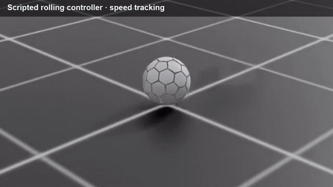
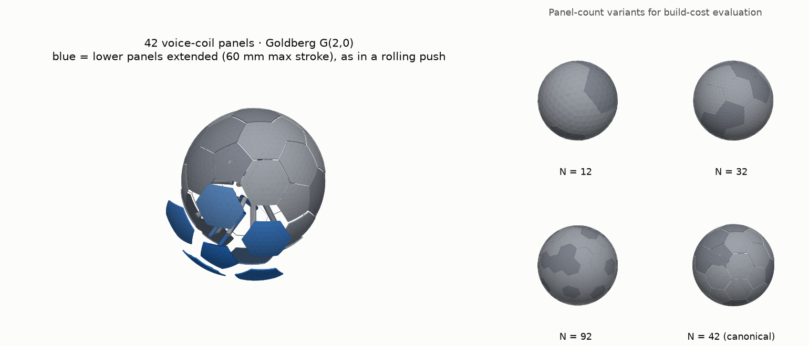

# Pebble: an expressive rolling robot trained with RL

Pebble is a simulated ball-shaped robot with no wheels. Its surface is 42 panels that push out against the floor, so it tips and rolls. The goal is a *character*, not just a robot that gets from A to B. It breathes while idle, rolls where you point the gamepad stick, and jumps on a button press. I trained its behaviours with reinforcement learning in NVIDIA Isaac Lab, using the same multi-policy approach Disney Research uses for its expressive robot characters.

   
  Pebble rolling under its scripted controller, then a trained policy rolling to goals in 8 directions.
  Full-quality video: <a href="media/pebble_demo.mp4">media/pebble_demo.mp4</a> (27 s).

## What it does

- **Rolls, steers and recovers.** It rolls in any direction at up to 0.8 m/s and recovers when pushed.
- **Drives like a character.** Separate learned behaviours for idling, rolling and jumping blend smoothly as you drive it with a gamepad.
- **Learns from demonstrations.** Recorded and scripted demonstrations give it a style, and reinforcement learning then improves on it.
- **Compares build options.** The design comes in several panel counts (12, 32, 42 and 92), so a cheaper physical build can be weighed against expressiveness.

   
  Left: the 42-panel robot with its lower panels extended mid-roll. Right: the panel-count variants.

## Built with

Python · PyTorch · NVIDIA Isaac Lab · PhysX · PPO (skrl)

## My role

I designed and built the project solo: the robot model, the simulation, the demonstration tools, training and the runtime controller.

The source is private. I'm happy to demo it or walk through it on request.
